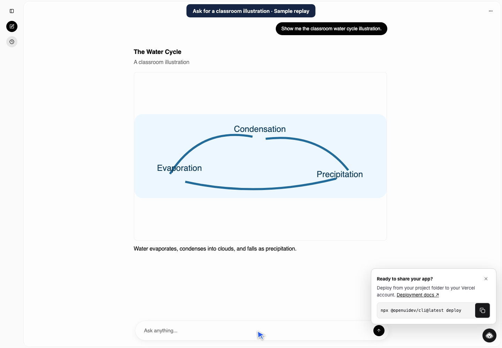

# KakkoiSchool Rich AI Chat

Standalone classroom prototype adapted from the OpenUI Vercel AI SDK example (MIT). Keep this prototype bound to localhost. Chats are stored in the browser; use sample questions rather than student records.

## Video walkthrough

[](https://raw.githubusercontent.com/KakkoiDev/rich-ai-chat/main/docs/walkthrough.webm)

[Watch or download the Playwright walkthrough](https://raw.githubusercontent.com/KakkoiDev/rich-ai-chat/main/docs/walkthrough.webm). The visible cursor follows the Izumo weather question, a Japanese follow-up, and an inline illustration. The weather shown is from a sample conversation.

## Run locally

1. Run `npm ci`.
2. Copy `.env.example` to `.env.local`. Set `MODEL_API_KEY` for DeepSeek Flash and `BRAVE_SEARCH_API_KEY` for live search.
3. Run `npm run dev -- --hostname 127.0.0.1 --port 3210` and open http://127.0.0.1:3210.
4. Try the search, water cycle image, and diagram prompts on the start screen.

DeepSeek's hosted endpoint receives chat text. To keep inference local, set `MODEL_BASE_URL` and `MODEL_ID` to a running OpenAI-compatible server and its model ID. For Ollama use `http://127.0.0.1:11434/v1`. Search still sends the short query to Brave; Safe Search and obvious personal-data checks reduce risk but cannot guarantee anonymity. Ask “Show me pictures of Mount Fuji” for a gallery with source links. Online thumbnails load through Brave’s image proxy; the bundled water-cycle illustration is still available. Ask “What time is it?” for the date or time in your browser’s time zone (UTC if unavailable), or name a city for another time zone. The app uses the Temporal API for calendar and clock values.

See [STEP-2.md](STEP-2.md) for the reusable PLH work.

## Build mini-apps and games

Ask for a calculator, a quiz, or a playable game. Choose **Run preview** to run the generated HTML, CSS, and JavaScript, or **View source** to inspect it. The preview starts only when you click Run. Controls run inside the preview without new chat messages. Stopping the preview clears its runtime state; the source stays in the conversation.

Previews use an iframe with an opaque origin and a restrictive content policy. They cannot use external scripts, API calls, or the chat's storage. Keep previews small: the sandbox does not guarantee a CPU or memory limit for generated JavaScript. File edits and GitHub PRs are separate future phases in [the design doc](APP-BUILDER-DESIGN.md).

### Play-test and revise

Run the preview and try the controls. The preview reports script errors and blocked browser operations as they happen. A clean startup check does not verify game rules or layout. Describe what went wrong or what should change, then click **Request revision**. The chat sends the current source, your notes, and up to five diagnostics to the configured model in one request. The revision appears as a new artifact, so you can test it without losing the original. **Restart test** resets the preview and clears the previous diagnostics.

### Dictate a message

Use **Dictate** beside Send, allow microphone access, and speak. Recording stops after a short pause; you can also click the stop icon. The Mac transcribes up to one minute and inserts the text into your draft for review. The audio is discarded after transcription and is not sent to the selected chat provider. The microphone works on localhost and on the private HTTPS link.

Dictation uses the same multilingual `mlx-community/whisper-base-mlx` model as PLH. On an Apple Silicon Mac with `uv`, run `uv run --python 3.12 scripts/transcribe.py sample.wav wav` once with a short speech recording to cache the Python dependencies and model. If PLH already uses a shared cache, set `HF_HOME` to that directory. The chat route runs offline and uses the same cache.

### Attach files

Click **+** to attach up to three UTF-8 text files (12 KB each), including TXT, Markdown, CSV, JSON, and source code. Remove any file before sending with **×**. The selected chat model reads the text after you send, and the most recent files remain available for follow-up questions. File text is saved with the conversation in the browser. Web search is disabled while attached text is in context.

### Switch models

Use the model picker beside the microphone to select DeepSeek Flash, GPT-OSS 20B, or Gemma 4 12B, E4B, or E2B. The selection is saved in this browser and applies to the next message or artifact revision. Switching models keeps the current thread.

Set `DEEPSEEK_API_KEY` on the server to enable DeepSeek even when the default model is local. DeepSeek receives the chat context for that turn. The local options use Ollama on port 11434 and need their corresponding model tags installed. **Server default** uses `MODEL_BASE_URL` and `MODEL_ID`.

### Try GPT-OSS 20B locally

With Ollama running and `gpt-oss:20b` installed, launch a second instance alongside the DeepSeek demo:

```sh
RICH_CHAT_BUILD_DIR=.next-local/gpt-oss \
MODEL_BASE_URL=http://127.0.0.1:11434/v1 \
MODEL_ID=gpt-oss:20b MODEL_API_KEY=local \
npm run dev -- --hostname 127.0.0.1 --port 3212
```

Open http://127.0.0.1:3212. Model inference stays local; web search still requires a Brave Search API key and sends the search query to Brave.

Revision requests use only the selected artifact, notes, and diagnostics. If the model times out or returns an incomplete artifact, the app makes one more attempt with a request for a smaller replacement. Each attempt has a 55-second limit and revision attempts cannot call tools. If both fail, the chat reports that the original artifact is still available.

For app and game build requests, the model receives a short guide for the requested kind of artifact, then returns a document for the app to check before rendering. The same checks run on revisions. They catch missing script closures, external scripts, common direct uses of dynamic evaluation, and syntax errors in classic inline JavaScript. A syntax diagnostic includes the script and line number when available; the retry gets that diagnostic. The checker does not run the code or prove game rules, accessibility, or layout. Use the preview to test those behaviors.

### Regression scenarios

See [scenario prompts](tests/scenarios.json) and [model evaluation notes](tests/MODEL-NOTES.md). Run the offline checks with `node tests/preflight.mjs` on Node 24+. With Playwright and Chromium available, run `CHAT_URL=http://127.0.0.1:3212/ node tests/e2e/slingshot.cjs` to verify the starter through chat. Omit CHAT_URL to test the standalone file. Plain slingshot build requests open the tested starter; use Request revision to customize it.

To compare GPT-OSS 20B with smaller models, run the [basic capability evaluation](tests/eval/README.md) against each model's chat server. It checks observable behavior and separates model performance from built-in app behavior.
